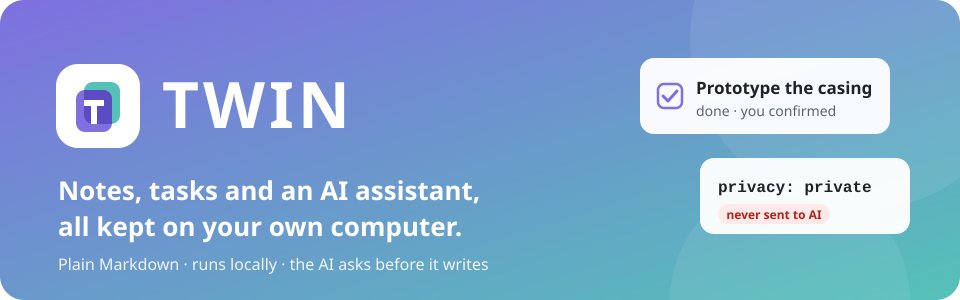
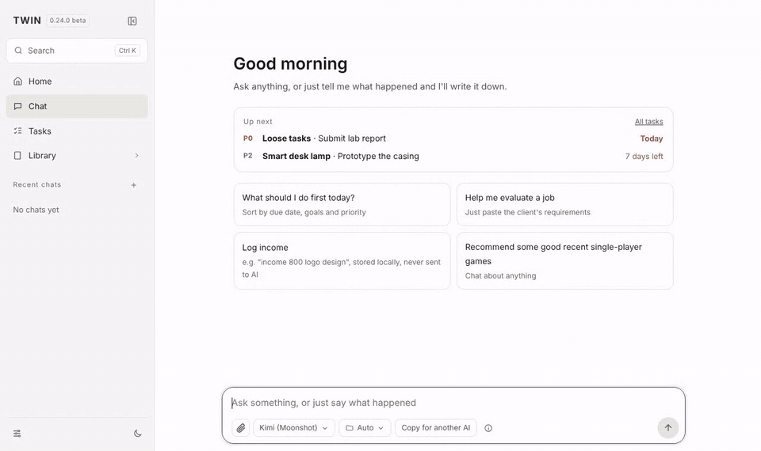
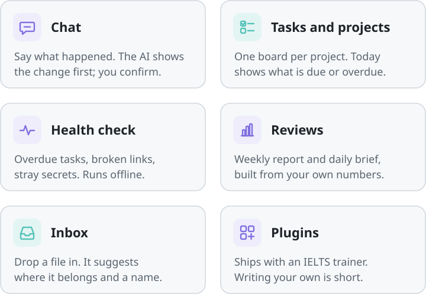
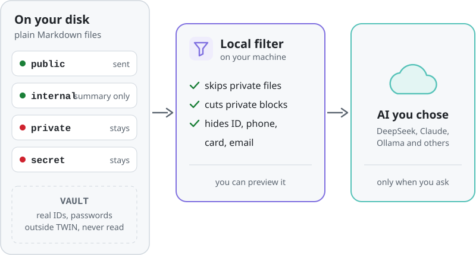
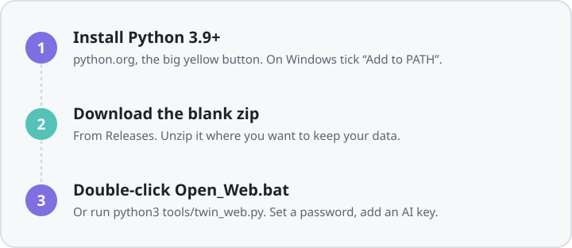

<p align="right"><b>English</b> · <a href="README.zh-CN.md">简体中文</a></p>

<p align="center">
  <picture>
    <source media="(prefers-color-scheme: dark)" srcset="docs/readme/hero-dark.svg">
    
  </picture>
</p>

<p align="center">
  <a href="../../releases/latest"></a>
  <a href="LICENSE"></a>
  
  
</p>

<p align="center">
  <a href="#getting-started">Getting started</a> ·
  <a href="#what-it-does">What it does</a> ·
  <a href="#privacy">Privacy</a> ·
  <a href="CHANGELOG.md">Changelog</a>
</p>

TWIN keeps your tasks, projects and notes as plain Markdown files in one folder on your computer. It runs a small web app on your own machine, and an AI assistant that knows your goals and projects can help, but only sees what you allow and never writes anything without asking.

I built it for myself and use it every day. It is still beta.

<p align="center"></p>
<p align="center"><sub>"Casing supplier is sorted." The AI shows the task list after the change; nothing is written until you confirm, and you can undo it. (Demo data.)</sub></p>

## What it does

<p align="center">
  <picture>
    <source media="(prefers-color-scheme: dark)" srcset="docs/readme/features-dark.svg">
    
  </picture>
</p>

- **No AI needed for the basics.** Tasks, projects, the health check and the home page all work offline. AI features only cost tokens when you click them.
- **Open files, no lock-in.** Everything is Markdown. Open the folder in Obsidian or any editor.
- **The AI asks first.** Ticking a task, adding one, filing a document: you see a preview and press confirm. Every write goes into a change history you can undo.
- **Also:** assets and contacts as cards with expiry reminders, weather and a daily rhythm bar, idle auto-lock, phone access over Tailscale, an IELTS practice plugin.

<table>
  <tr>
    <td width="50%"></td>
    <td width="50%"></td>
  </tr>
  <tr>
    <td align="center"><sub><b>Today</b>: what is due or overdue, by project</sub></td>
    <td align="center"><sub><b>Project</b>: tasks, subtasks and due dates</sub></td>
  </tr>
</table>

## Privacy

<p align="center">
  <picture>
    <source media="(prefers-color-scheme: dark)" srcset="docs/readme/privacy-dark.svg">
    
  </picture>
</p>

- The web app listens on 127.0.0.1 only. Nothing is uploaded unless you use an AI feature, and then only to the provider you picked.
- Every file has `privacy: public / internal / private / secret` at the top. Files without it count as secret.
- Before sending, TWIN drops private and secret files, cuts `<!-- private -->` blocks, and replaces anything that looks like an ID number, phone number, bank card or email.
- Real secrets belong in a vault folder **outside** TWIN. Notes only hold placeholders like `{{VAULT:name}}`.
- The full rules are in [`_RULES/AI_ACCESS_RULES.md`](_RULES/AI_ACCESS_RULES.md). Your AI tools can read them too.

## Getting started

<p align="center">
  <picture>
    <source media="(prefers-color-scheme: dark)" srcset="docs/readme/start-dark.svg">
    
  </picture>
</p>

1. **Python 3.9 or newer.** On [python.org/downloads](https://www.python.org/downloads/) the big yellow button is the right one. On Windows, tick *Add python.exe to PATH* in the installer. No other packages are needed.
2. **Get TWIN.** Download `TWIN-blank-<version>.zip` from the [latest release](../../releases/latest) and unzip it where you want your data to live, or `git clone` this repo.
3. **Start it.** Windows: double-click `Open_Web.bat`. macOS / Linux: `python3 tools/twin_web.py`. The browser opens http://127.0.0.1:8765. Set a password, fill in as much of the short setup as you like, and add an AI key under **Settings → AI** (DeepSeek, Kimi, Qwen, OpenAI, Claude, Ollama and others). Keys are kept in `~/.twin/ai.json`, not in the TWIN folder.

The interface is Chinese by default; switch to English under **Settings → General → Interface language**.

Updates: **Settings → Version** checks this repo's latest release and installs it. Only the program is replaced; your notes are not touched, and the old program is backed up to `_export/` first.

<details>
<summary><b>Folder layout</b></summary>

```text
00_Crown/        profile, goals, overview
01_Skills/       skills: engineering, academic, language...
02_Life/         cooking, sports, health, money...
03_Projects/     one folder per project, tasks in board.md
04_Milestones/   education, competitions, research, career
05_Network/      people (private by default)
06_Assets/       devices, subscriptions, leases (private by default)
07_Decisions/    decisions and how they turned out
_RULES/          AI access rules, field spec
_TEMPLATES/      templates for new files
tools/           the program (twin_web.py + tools/web/)
```

Each branch has a `_SUMMARY.md` with its conclusions. That is the first thing the AI reads; the individual files stay local unless they are public.

Git only tracks the program, docs and shared rules (see `.gitignore`), so your own notes never end up in a commit.
</details>

<details>
<summary><b>Phone access</b></summary>

Install [Tailscale](https://tailscale.com/) on your computer and phone, same account. Run `python tools/twin_web.py --phone`, then open the `http://100.x.x.x:8765` address it prints on your phone. TWIN listens only on the Tailscale interface, so nothing else on your Wi-Fi can reach it.
</details>

<details>
<summary><b>Command line</b></summary>

```bash
python tools/twin.py scan     # look for plain-text sensitive values
python tools/twin.py pack     # build context_pack.md to paste into a web AI
python tools/twin.py blank    # build a blank copy with none of your data (in _export/)
```
</details>

<details>
<summary><b>Releasing (maintainers)</b></summary>

1. Bump `VERSION` in `tools/twin_web.py` and turn "未发布" in the changelog into the version and date.
2. `python tools/twin.py blank` builds the blank zip in `_export/`.
3. Create a GitHub release tagged `v<version>` with the zip attached. Publish it as a normal release, not a pre-release: the updater reads `/releases/latest`, which skips pre-releases.
</details>

## License

[MIT](LICENSE). The IELTS word list comes from [ECDICT](https://github.com/skywind3000/ECDICT) (MIT); see `tools/plugins/ielts/SOURCES.md`. Issues and pull requests are welcome.
