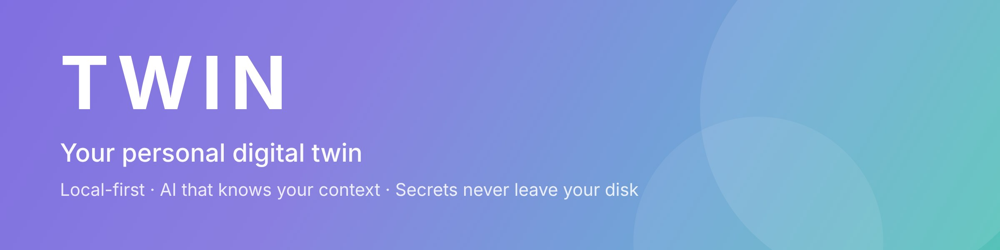
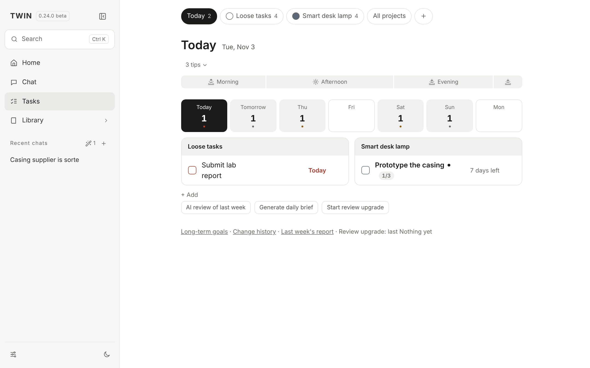
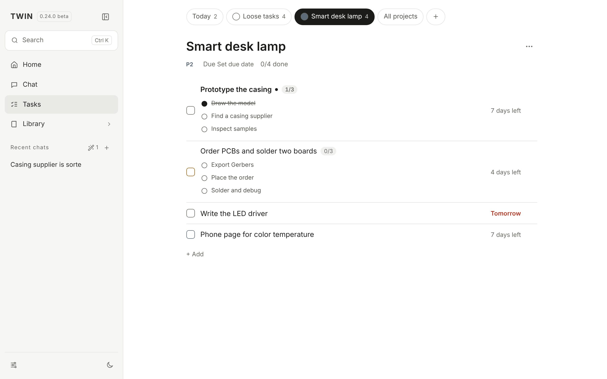

<p align="center"></p>

<p align="center">
  <a href="../../releases"></a>
  <a href="LICENSE"></a>
  
  
  
</p>

<p align="center">
  <b>A personal operating system that runs on your own computer.</b><br>
  Tasks, projects, reviews and notes live in plain Markdown files on your disk.<br>
  An AI assistant helps you decide with your full context, and sensitive data never leaves the machine.
</p>

<p align="center">
  <a href="#-getting-started">Getting started</a> ·
  <a href="#-features">Features</a> ·
  <a href="#-privacy">Privacy</a> ·
  <a href="CHANGELOG.md">Changelog</a>
</p>

<p align="center"></p>
<p align="center"><sub>Tell it the casing supplier is sorted. The AI shows what the task list will look like, nothing is written until you confirm, and every change can be undone. (Demo data.)</sub></p>

## 💡 Why TWIN

Most note apps either just store your notes, with an AI that can't do much, or they have a capable AI that wants all your data in the cloud. TWIN tries to get both:

- **Your data stays local.** Everything is plain Markdown. Open it in Obsidian or any text editor. No lock-in.
- **The AI has context, and follows rules.** It sees your profile, goals and project progress, so its advice is about you. Files marked private, `<!-- private -->` blocks, and anything that looks like an ID number, phone number or bank card are stripped before anything is sent. Real secrets live in a vault outside the knowledge base; notes only hold placeholders.
- **The AI asks before it acts.** When it wants to tick a task, add one or write a note, it first shows a preview of the result. Nothing is written until you confirm, and every write goes into a change history you can undo.
- **AI is optional.** Tasks, projects, the health check and the home page all run locally without it. AI features only spend tokens when you click them.

## 🧭 Features

| | |
|---|---|
| 💬 **Chat** | Ask anything. Say "the test board works" or "add a colour review" and the AI proposes ticking or adding tasks. As you talk about a project, it records real facts (hardware, requirements, decisions) in the project profile, so the picture gets clearer over time. |
| ✅ **Tasks and projects** | One task table per project: priority, due date, subtasks, completion notes. The Today view collects what is overdue or due today, and you can flip to any day of the week. Due dates that keep getting pushed back are flagged. |
| 🩺 **Health check** | Runs locally: overdue tasks, stale projects, broken links, empty summaries, files without a privacy level, likely sensitive values. No AI involved. |
| 📈 **Reviews** | Weekly report, daily brief, daily suggestions, and a review loop where the AI tunes its scoring rules from your feedback. |
| 📥 **Inbox** | Drop files into the chat. They land in an inbox and the AI suggests where to file them and what to call them. You confirm. |
| 🗂️ **Assets and people** | Devices, subscriptions, leases and contacts as cards, with expiry reminders. Private by default. |
| 🧩 **Plugins** | Ships with an IELTS plugin (vocabulary, sentence patterns, reading, spaced repetition). Write your own. |
| ✨ **And more** | Home page widgets, weather and a daily rhythm bar, idle auto-lock, phone access over Tailscale. |

<table>
  <tr><td align="center"><b>Today</b>: what's overdue or due today, grouped by project</td><td align="center"><b>Project</b>: tasks, subtasks and due dates at a glance</td></tr>
  <tr><td></td><td></td></tr>
</table>

## 🚀 Getting started

You need **Python 3.9 or newer**. No third-party packages.

> **Which Python?** Go to [python.org/downloads](https://www.python.org/downloads/) and click the big yellow **Download Python** button at the top. That is the latest version and it is the right one; ignore the long list of older releases below it. On Windows, tick **"Add python.exe to PATH"** on the first page of the installer, then click *Install Now*. If Python is missing, `Open_Web.bat` tells you and opens the download page.

1. Download `TWIN-空白版-<version>.zip` from the latest [release](../../releases) and unzip it where you want to keep your data, for example `D:\TWIN`. Or just `git clone` this repository.
2. On Windows, double-click `Open_Web.bat`. On macOS or Linux, run `python3 tools/twin_web.py` inside the TWIN folder. Your browser opens http://127.0.0.1:8765 .
3. On first launch, set an access password (8+ characters), then go through the short setup: profile (all optional), city (for weather), daily rhythm template, and an AI provider.
4. Add an API key under **Settings → AI providers**. DeepSeek, Kimi, Qwen, OpenAI, Claude, local Ollama and others work. Keys are stored in `~/.twin/ai.json` in your user folder, not in the knowledge base.

> **Language:** the interface is Chinese by default. Switch to English under **Settings → General → Interface language**; the AI then replies in English too. Your own notes and task names are never translated. Task table headers, templates and AI rules are still Chinese for now.

## 🔒 Privacy

- The server only listens on your own machine (127.0.0.1) and uploads nothing. Only when you use an AI feature is **filtered** content sent, to the provider you chose.
- Every file starts with `privacy: public / internal / private / secret`. The AI never sees `private` or `secret` files. Files without the field are treated as secret.
- Before anything is sent, `<!-- private -->` blocks are removed and values that look like ID numbers, phone numbers, bank cards or email addresses are blocked. The rules live in `_RULES/AI_ACCESS_RULES.md`, readable by you and the AI.
- Money amounts you log are handled locally and never sent to the AI.
- Real secrets go in a vault **outside** the TWIN folder (for example a `VAULT` folder next to it). Notes only contain `{{VAULT:name}}`. When you give an AI tool access, give it the TWIN folder only.
- "Copy for another AI" shows you everything it will copy first.

## 🌳 Folder layout

```text
00_Crown/        top of the tree: profile, goals, overview
01_Skills/       work skills: engineering, academic, language, social, thinking, business
02_Life/         life: cooking, sports, health, music, hobbies, money...
03_Projects/     one folder per project, tasks in board.md
04_Milestones/   education, competitions, research, career, life events
05_Network/      people: mentors, collaborators, friends (private by default)
06_Assets/       devices, subscriptions, leases, things (private by default)
07_Decisions/    decisions and how they turned out
_RULES/          AI access rules, field spec
_TEMPLATES/      templates for new files
tools/           the program: twin_web.py is the local web app, front end in tools/web/
```

Each branch has a `_SUMMARY.md`: the conclusions for that branch, and the first layer the AI reads. Conclusions, not details.

**Three layers of data:** leaves (individual files, local only) → stems (each branch's `_SUMMARY.md`, may go to the AI) → crown (`00_Crown/`, plans and open decisions).

## 📱 Phone access

1. Install [Tailscale](https://tailscale.com/) on your computer and phone and sign in to the same account.
2. Start TWIN with `python tools/twin_web.py --phone`. It prints an address like `http://100.x.x.x:8765`. Open Tailscale on your phone, then that address in the browser.

TWIN only listens on the Tailscale interface: other devices on your Wi-Fi and the internet can't reach it, only devices signed in to your account.

## ⌨️ Command line

```bash
python tools/twin.py scan     # look for plain-text sensitive values
python tools/twin.py pack     # build context_pack.md, the one file to paste into a web AI
python tools/twin.py blank    # build a blank copy with none of your data (in _export/)
```

## 🧷 Git tracks the program only

`.gitignore` only admits the program, docs, shared rules and templates. **Your own data never goes into Git**, so you can `git pull` program updates inside your own TWIN folder. If you break a note, restore it from the change history in the web app.

## 📦 Releasing (for maintainers)

1. Put "user/repo" into `REPOS` in `tools/twin_update.py` (once). Other TWIN installs can then check for and install updates under Settings → Version. Without a repo, send people the new blank zip: they upgrade with **Settings → Version → Upgrade from file**.
2. Bump `VERSION` in `tools/twin_web.py` and turn "未发布" in the changelog into the version and date.
3. Run `python tools/twin.py blank` to build the blank zip.
4. Create a GitHub release tagged `v<version>` (for example `v0.26.0-beta`), attach the zip and paste that version's changelog. Upgrades back up the old program, replace only the program and docs, and leave user data alone.

## 🚧 Status

Beta. The author uses it every day. Features and file formats will still change. Issues and PRs welcome.

## 📄 License

[MIT](LICENSE). The IELTS word list comes from [ECDICT](https://github.com/skywind3000/ECDICT) (MIT); see `tools/plugins/ielts/SOURCES.md`.
