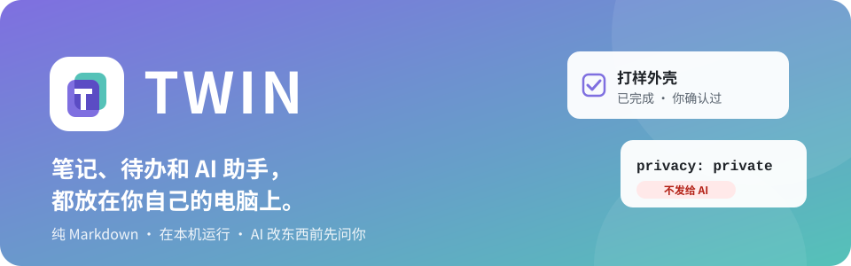
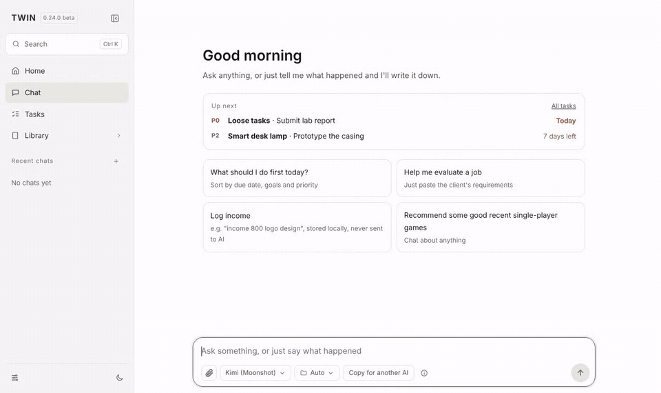
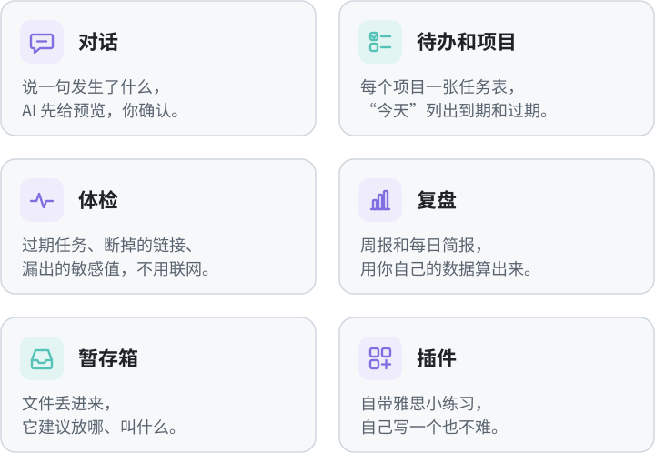
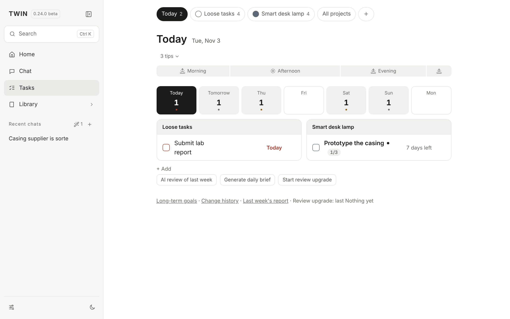
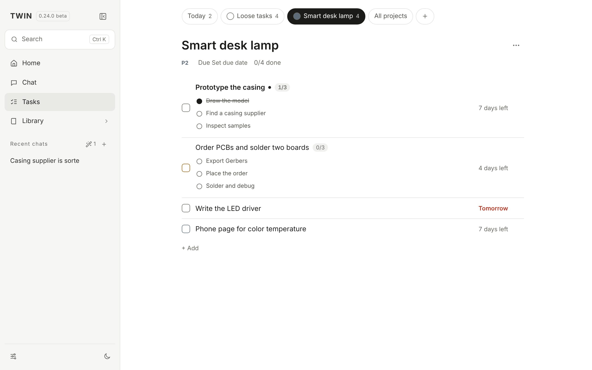
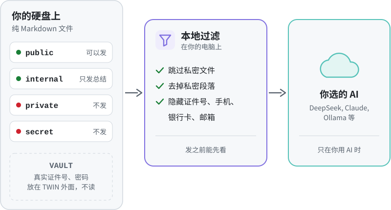
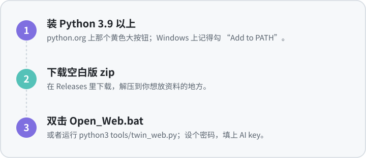

<p align="right"><a href="README.md">English</a> · <b>简体中文</b></p>

<p align="center">
  <picture>
    <source media="(prefers-color-scheme: dark)" srcset="docs/readme/hero-zh-dark.svg">
    
  </picture>
</p>

<p align="center">
  <a href="../../releases/latest"></a>
  <a href="LICENSE"></a>
  
  
</p>

<p align="center">
  <a href="#上手">上手</a> ·
  <a href="#能做什么">能做什么</a> ·
  <a href="#隐私">隐私</a> ·
  <a href="CHANGELOG.md">修改日志</a>
</p>

TWIN 把你的待办、项目和笔记存成一个文件夹里的普通 Markdown 文件，放在你自己的电脑上。它在本机跑一个小网页，带一个知道你的目标和项目的 AI 助手；AI 只看得到你允许的内容，改任何东西之前都会先问你。

这是我给自己做的，每天都在用，现在还是测试版。

<p align="center"></p>
<p align="center"><sub>说一句“外壳供应商搞定了”。AI 先给出改完后的任务表，你确认之前什么都不写，写了也能撤销。（演示数据，界面是英文模式。）</sub></p>

## 能做什么

<p align="center">
  <picture>
    <source media="(prefers-color-scheme: dark)" srcset="docs/readme/features-zh-dark.svg">
    
  </picture>
</p>

- **基本功能不用 AI。** 待办、项目、体检、首页都能离线用。AI 功能只有你点了才花 token。
- **文件是开放的，不绑死。** 全是 Markdown，用 Obsidian 或任何编辑器都能打开。
- **AI 先问再做。** 打钩、加任务、归档文件，都先给你看预览，点确认才写；每次写入都记在“改动历史”里，可以撤销。
- **还有：** 资产和人脉卡片（带到期提醒）、天气和作息条、离开自动锁定、用 Tailscale 在手机上访问、雅思小练习插件。

<table>
  <tr>
    <td width="50%"></td>
    <td width="50%"></td>
  </tr>
  <tr>
    <td align="center"><sub><b>今天</b>：按项目列出到期和过期的任务</sub></td>
    <td align="center"><sub><b>项目</b>：任务、子任务和截止日期</sub></td>
  </tr>
</table>

## 隐私

<p align="center">
  <picture>
    <source media="(prefers-color-scheme: dark)" srcset="docs/readme/privacy-zh-dark.svg">
    
  </picture>
</p>

- 网页只在 127.0.0.1 上监听。不用 AI 功能就什么都不上传；用的时候也只发给你自己选的那家。
- 每个文件开头写 `privacy: public / internal / private / secret`，没写的一律按 secret 算。
- 发出去之前，TWIN 会去掉 private 和 secret 文件、剪掉 `<!-- private -->` 段落，把像证件号、手机号、银行卡、邮箱的内容换掉。
- 真正的机密放在 TWIN **外面**的保险箱文件夹里，笔记里只写 `{{VAULT:名称}}` 这样的占位符。
- 完整规则在 [`_RULES/AI_ACCESS_RULES.md`](_RULES/AI_ACCESS_RULES.md)，你用的 AI 工具也能读到。

## 上手

<p align="center">
  <picture>
    <source media="(prefers-color-scheme: dark)" srcset="docs/readme/start-zh-dark.svg">
    
  </picture>
</p>

1. **Python 3.9 或更新。** 在 [python.org/downloads](https://www.python.org/downloads/) 点最上面黄色的大按钮就对了。Windows 安装时第一页勾上 *Add python.exe to PATH*。不用装别的包。
2. **下载 TWIN。** 在[最新的 Release](../../releases/latest) 里下载 `TWIN-blank-<版本>.zip`，解压到你想放资料的地方；或者直接 `git clone` 这个仓库。
3. **打开。** Windows 双击 `Open_Web.bat`；macOS / Linux 运行 `python3 tools/twin_web.py`。浏览器会打开 http://127.0.0.1:8765 。设一个密码，引导里想填多少填多少，再到 **设置 → AI** 填一个 key（DeepSeek、Kimi、通义千问、OpenAI、Claude、Ollama 等都行）。key 存在 `~/.twin/ai.json`，不在 TWIN 文件夹里。

界面默认是中文，可以在 **设置 → 通用 → 界面语言** 换成英文。

更新：**设置 → 版本** 会检查这个仓库最新的 Release 并一键安装。只换程序，你的笔记不动，旧程序先备份到 `_export/`。

<details>
<summary><b>目录结构</b></summary>

```text
00_Crown/        个人画像、目标、总览
01_Skills/       技能：工程、学术、语言……
02_Life/         做饭、运动、健康、理财……
03_Projects/     一个项目一个文件夹，任务在 board.md
04_Milestones/   教育、比赛、科研、工作
05_Network/      人脉（默认私密）
06_Assets/       设备、订阅、租约（默认私密）
07_Decisions/    做过的决定和结果
_RULES/          AI 访问规则、字段规范
_TEMPLATES/      新建文件用的模板
tools/           程序本身（twin_web.py + tools/web/）
```

每个分支有一份 `_SUMMARY.md`，写这一支的结论，AI 最先读的就是它；具体文件除非是 public，否则只留在本机。

Git 只记程序、说明和通用规则（见 `.gitignore`），你自己的笔记不会进提交。
</details>

<details>
<summary><b>手机访问</b></summary>

电脑和手机都装 [Tailscale](https://tailscale.com/)，登同一个账号。运行 `python tools/twin_web.py --phone`，在手机浏览器打开它打印出来的 `http://100.x.x.x:8765`。TWIN 只在 Tailscale 网卡上监听，同一个 Wi-Fi 里的其他设备访问不到。
</details>

<details>
<summary><b>命令行</b></summary>

```bash
python tools/twin.py scan     # 找明文的敏感值
python tools/twin.py pack     # 生成 context_pack.md，贴给网页版 AI
python tools/twin.py blank    # 打一个不含任何资料的空白版（在 _export/）
```
</details>

<details>
<summary><b>发版本（维护者）</b></summary>

1. 改 `tools/twin_web.py` 里的 `VERSION`，把修改日志里的“未发布”改成版本号和日期。
2. `python tools/twin.py blank` 在 `_export/` 里打出空白版 zip。
3. 在 GitHub 建一个 `v<版本>` 的 Release，附上 zip。要发成正式版，不要勾预发布：升级读的是 `/releases/latest`，它会跳过预发布版。
</details>

## 许可

[MIT](LICENSE)。雅思词表来自 [ECDICT](https://github.com/skywind3000/ECDICT)（MIT），见 `tools/plugins/ielts/SOURCES.md`。欢迎提 Issue 和 PR。
